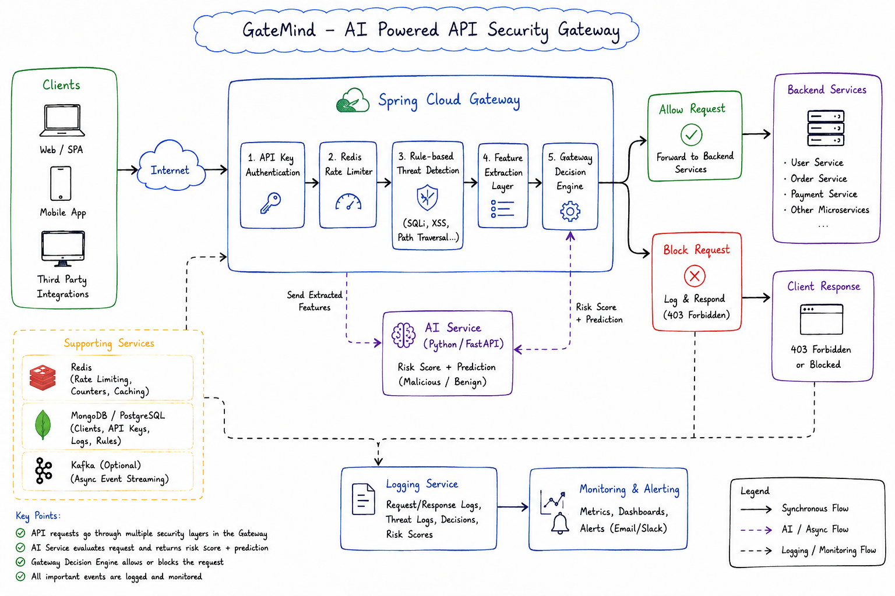

# GateMind

GateMind is an AI-powered API security gateway designed to protect backend APIs from unauthorized access, excessive traffic, and malicious requests.

## Architecture

Add the system architecture diagram here.



## Overview

GateMind sits between clients and backend services and performs security checks before forwarding requests.

The gateway handles:

* API key authentication
* Rate limiting using Redis
* Rule-based threat detection
* AI-based threat analysis
* Request routing and filtering

The system is built using a microservice architecture consisting of a Gateway Service, Client Registration Service, AI Security Service, and an Admin Dashboard.


## Why GateMind Exists

GateMind is an API security gateway designed to protect backend services from malicious and abnormal HTTP requests.

A frontend cannot be trusted as a security layer because attackers can bypass it and directly communicate with backend APIs using tools such as Postman, cURL, Burp Suite, scripts, or custom applications.

GateMind sits between clients and backend services and provides multiple layers of protection:

- `API Key Authentication` — verifies registered clients.
- `Rate Limiting` — controls excessive API requests using Redis.
- `Rule-Based Threat Detection` — detects known attack patterns.
- `AI-Based Threat Detection` — identifies suspicious and anomalous requests that may not match predefined rules.
- `Centralized Security Layer` — makes security decisions before requests reach backend services.

The goal of GateMind is to provide **defense in depth for APIs**, combining traditional security rules with intelligent threat detection to protect backend services from both known and potentially unknown attacks.

## Tech Stack

* Java
* Spring Boot
* Spring Cloud Gateway
* Spring WebFlux
* Redis
* PostgreSQL
* Python
* Machine Learning
* React
* Docker

## Services

### Gateway Service

Handles incoming API requests, authentication, rate limiting, threat detection, and routing.

### Client Registration Service

Handles client registration and API key generation and management.

### AI Security Service

Analyzes API requests and identifies potentially malicious traffic using a machine learning model.

### Admin Dashboard

Provides a frontend for monitoring API traffic and security events.

## Project Structure

```text
GateMind/
├── gateway-service/
├── client-service/
├── ai-service/
├── admin-dashboard/
├── docs/
│   └── architecture.png
└── README.md
```

## Running the Project

Start Redis and PostgreSQL, then run each service separately.

```bash
# Gateway
cd gateway-service
mvn spring-boot:run

# Client Service
cd client-service
mvn spring-boot:run

# AI Service
cd ai-service
python app.py

# Dashboard
cd admin-dashboard
npm install
npm run dev
```

## Goal

The goal of GateMind is to combine traditional API gateway security with machine learning to provide a more intelligent and adaptive layer of API protection.
